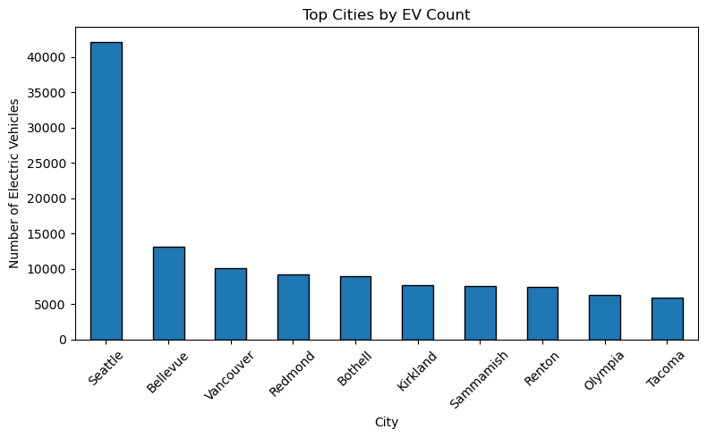

[Back to portfolio site](https://mccarthyleechris.github.io/data-science-portfolio/) · [All projects](../README.md)

# EV and Charging Station Data Pipeline (CSV, Web Scraping, API and SQL)

How do electric vehicle counts compare with charging infrastructure across Washington cities?

This project pulls three very different data sources into one SQLite database: a flat CSV file, a table scraped from a government website, and JSON from a REST API. Each source was cleaned in five documented steps before the three were merged with SQL and charted.



## Sources

| Source | Format | What it adds |
|---|---|---|
| [Washington EV Population Data](https://data.wa.gov/Transportation/Electric-Vehicle-Population-Data/f6w7-q2d2) | CSV | Every registered EV in the state, with city, make, type and electric range |
| [Alternative Fuels Data Center laws and incentives matrix](https://afdc.energy.gov/laws/matrix?sort_by=tech) | HTML table, scraped with `pandas.read_html` | Count of federal and state laws and incentives by fuel technology |
| [Open Charge Map API](https://openchargemap.org/site/develop/api) | JSON | Charging stations within 50 km of Seattle, with the number of charge points at each |

## Pipeline

1. Clean each source in five documented steps, such as standardizing column names, trimming to relevant columns, handling missing values, removing duplicates and flagging outliers with the IQR method.
2. Load the three cleaned tables into SQLite (`ev_population`, `fuel_technology`, `charging_stations`).
3. Merge them with a SQL query that counts EVs by city and joins station counts and average charge points per station.
4. Chart the merged data.

## Findings

- Seattle has by far the most registered EVs (about 42,000), followed by Bellevue, Vancouver and Redmond.
- Most charging stations near Seattle have 2 charge points; 4 is the next most common.
- Electricity is the alternative fuel technology with the most laws and incentives in the AFDC matrix.
- Average electric range is similar across most Washington cities, even where EV counts differ widely.

## Repository contents

```
ev-charging-data-pipeline/
├── README.md
├── ev_charging_pipeline.ipynb           # final notebook: all cleaning, SQL merge and charts
├── milestones/
│   ├── 1_csv_ev_registrations.ipynb      # cleaning the CSV
│   ├── 2_web_scraping_afdc_laws.ipynb    # scraping and cleaning the AFDC table
│   └── 3_api_openchargemap.ipynb         # pulling and cleaning the API data
├── data/                                # download the CSV here (see data/README.md)
└── figures/                             # 6 exported charts
```

## How to run

```
pip install pandas numpy matplotlib requests lxml jupyter
jupyter notebook ev_charging_pipeline.ipynb
```

1. Download the EV Population CSV and save it as `data/Electric_Vehicle_Population_Data.csv`.
2. Get a free API key from [Open Charge Map](https://openchargemap.org/site/develop/api) and paste it where the notebook says `YOUR_OPENCHARGEMAP_API_KEY`.
3. The AFDC table is scraped live, so you need an internet connection.

The notebook writes `ev_project.db` (about 70 MB) to the project folder. It isn't stored in the repo.

## Ethical considerations and limitations

Cleaning choices, such as which columns to keep and how to handle missing values, shape the results, so each step is documented in the notebooks. The API call returns at most 100 stations, so the station counts are a sample of the Seattle area rather than a full census. City names had to match exactly across sources, so some cities may be missing station data.

## Tools

Python, pandas, requests, SQLite, matplotlib, Jupyter
