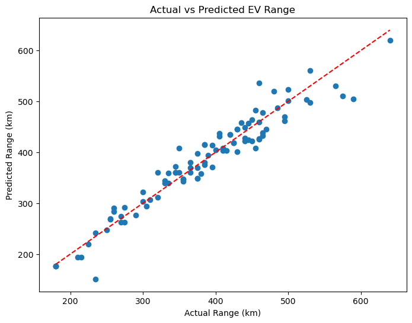

[Back to portfolio site](https://mccarthyleechris.github.io/data-science-portfolio/) · [All projects](../README.md)

# Predicting Electric Vehicle Driving Range with Regression

Which vehicle specs best predict how far an EV can travel on one charge?

Range is one of the first things people check when they shop for an electric vehicle. This project uses 2025 specifications for 478 EV models to measure how battery size, efficiency, torque and vehicle class each affect range, then tests how well a regression model can predict range from those specs.



## Results

| Model | Features | R² | RMSE |
|---|---|---|---|
| Simple linear regression | Battery capacity only | 0.77 | 49 km |
| Multiple linear regression | Battery capacity, efficiency, torque, vehicle segment | **0.93** | **26 km** |

Battery capacity is the strongest single predictor: on its own it explains about 77% of the variation in range. Adding efficiency, torque and segment nearly halves the prediction error, from 49 km to 26 km.

Efficiency has a negative coefficient. That fits the data, because the dataset measures efficiency in Wh/km (energy used per kilometer), so a higher value means a less efficient car with less range. Large, luxury and executive vehicles get more range than battery size alone would predict.

The residuals show no obvious pattern and average 1.4 km, so the model does not consistently over- or under-predict.

## Research questions

1. Which vehicle characteristics are most strongly associated with driving range?
2. Can battery capacity alone accurately predict driving range?
3. Does a multiple regression model beat a simple one?
4. How do vehicle segment and manufacturer relate to range?

## Data

- Source: [Electric Car Performance and Battery Dataset (Kaggle)](https://www.kaggle.com/datasets/afnansaifafnan/electric-car-performance-and-battery-dataset), file `electric_vehicles_spec_2025.csv`
- Size: 478 vehicles, 22 columns
- Target: `range_km`
- Predictors: `battery_capacity_kWh`, `efficiency_wh_per_km`, `torque_nm`, `segment` (one-hot encoded)
- Cleaning: removed 7 rows with missing torque values, and checked for duplicates and data types

## Approach

1. Exploratory analysis: histograms, scatter plots against range, average range by brand and by segment, and a correlation heatmap.
2. Baseline: simple linear regression on battery capacity, with an 80/20 train/test split.
3. Full model: multiple linear regression with one-hot encoded segments.
4. Diagnostics: a coefficient table, an actual-versus-predicted plot and a residual plot.

## Repository contents

```
ev-range-prediction/
├── README.md
├── ev_range_prediction.ipynb     # full analysis notebook
├── data/                         # download the CSV here (see data/README.md)
├── figures/                      # 9 exported charts
└── report/
    ├── ev_range_report.pdf       # written report
    └── ev_range_slides.pdf       # presentation slides
```

## How to run

```
pip install pandas numpy matplotlib scikit-learn jupyter
jupyter notebook ev_range_prediction.ipynb
```

Download the dataset from the Kaggle link above and save it as `data/electric_vehicles_spec_2025.csv`.

## Limitations and next steps

The range figures come from manufacturers, and real-world range also depends on weather, speed and terrain. Many models appear several times as near-identical trims, which can inflate test scores; splitting train and test data by model would be a stricter check.

Next, I'd like to try ridge regression and a random forest, and add charging speed as a feature.

## Tools

Python, pandas, NumPy, matplotlib, scikit-learn, Jupyter
