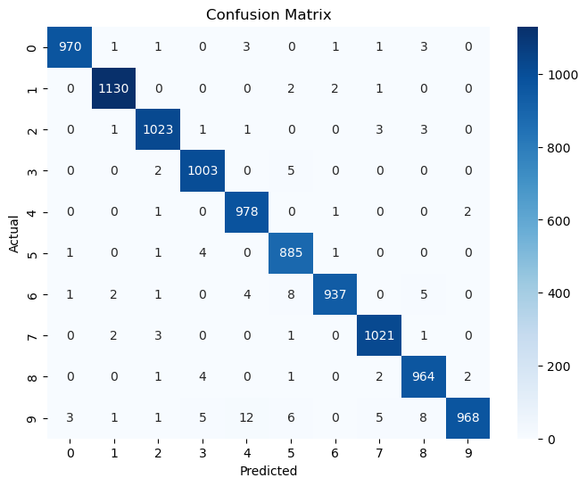

[Back to portfolio site](https://mccarthyleechris.github.io/data-science-portfolio/) · [All projects](../README.md)

# Handwritten Digit Recognition with a Convolutional Neural Network

Can a small neural network learn to read handwritten digits?

This project trains a convolutional neural network (CNN) on MNIST, the standard set of 70,000 handwritten digits from 0 to 9, and checks which digits it still confuses.



## Results

- Test accuracy: **98.8%** on the 10,000 held-out test images after five epochs.
- Validation accuracy reached 98.3% after the first epoch, so the model learns most of what it needs very quickly.
- Of the 121 test images it got wrong, the most common mistake was reading a 9 as a 4 (12 times). The digit 9 had the most errors (41), and 4 had the fewest (4).

## Data

MNIST is built into Keras (`tf.keras.datasets.mnist.load_data()`), so there's nothing to download. It has 60,000 training images and 10,000 test images, each 28 × 28 pixels in grayscale.

## Approach

1. Loaded MNIST and displayed the first five training images with their labels.
2. Reshaped images to 28 × 28 × 1 and scaled pixel values from 0-255 down to 0-1.
3. Built the model:

```
Conv2D(32, 3×3, ReLU) → MaxPooling(2×2)
Conv2D(64, 3×3, ReLU) → MaxPooling(2×2)
Flatten → Dense(128, ReLU) → Dense(10, softmax)
```

4. Trained for five epochs, holding out 10% of the training set for validation.
5. Evaluated on the test set and plotted a confusion matrix of actual vs. predicted digits.

## Repository contents

```
mnist-digit-cnn/
├── README.md
├── mnist_cnn.ipynb   # full notebook
└── figures/          # sample images and confusion matrix
```

## How to run

```
pip install tensorflow numpy matplotlib seaborn scikit-learn jupyter
jupyter notebook mnist_cnn.ipynb
```

Training takes about two minutes on a laptop CPU.

## Limitations and next steps

MNIST digits are centered and cleaned up, so real-world handwriting would be harder. Next, I'd add dropout and data augmentation (small rotations and shifts) and test the model on my own handwriting.

## Tools

Python, TensorFlow/Keras, NumPy, matplotlib, seaborn, scikit-learn, Jupyter
