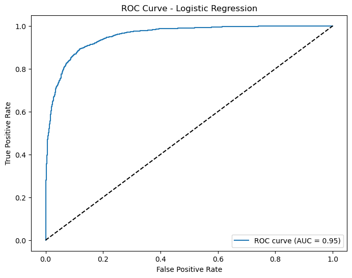

[Back to portfolio site](https://mccarthyleechris.github.io/data-science-portfolio/) · [All projects](../README.md)

# Movie Review Sentiment Analysis (NLP)

Can a model tell whether a movie review is positive or negative from the text alone, and does training a model beat off-the-shelf sentiment tools?

This project classifies 25,000 labeled IMDB reviews. It first tests two ready-made lexicon tools, then trains two classifiers on TF-IDF features and compares the results.



## Results

| Method | Type | Accuracy |
|---|---|---|
| TextBlob | Lexicon (no training) | 0.69 |
| VADER | Lexicon (no training) | 0.69 |
| Naive Bayes on TF-IDF | Trained classifier | 0.85 |
| Logistic regression on TF-IDF | Trained classifier | **0.88** (AUC 0.95) |

The lexicon tools only beat random guessing (50% on this balanced dataset) by about 19 points. A logistic regression trained on the reviews themselves gets 88% right, with balanced precision and recall for both classes.

## Data

- Source: [Bag of Words Meets Bags of Popcorn (Kaggle)](https://www.kaggle.com/c/word2vec-nlp-tutorial/data), file `labeledTrainData.tsv`
- Size: 25,000 reviews, split evenly between positive and negative (about 33 MB, so it isn't stored in this repo)

## Approach

1. Lexicon baseline (notebook 1): scored each review with TextBlob polarity and VADER compound scores and labeled it positive if the score was zero or above.
2. Text cleaning (notebook 2): kept only letters, lowercased, removed English stopwords (NLTK) and applied Porter stemming.
3. Features: 80/20 train/test split, then TF-IDF with the 5,000 most frequent terms.
4. Models: logistic regression and multinomial Naive Bayes, evaluated with accuracy, classification reports and ROC curves.

## Repository contents

```
movie-review-sentiment-nlp/
├── README.md
├── 1_lexicon_sentiment_textblob_vader.ipynb    # TextBlob and VADER baselines
├── 2_tfidf_logistic_regression_naive_bayes.ipynb  # cleaning, TF-IDF and trained models
├── data/                                       # download the TSV here (see data/README.md)
└── figures/                                    # ROC curves
```

## How to run

```
pip install pandas numpy scikit-learn nltk textblob vaderSentiment matplotlib jupyter
python -m nltk.downloader stopwords
jupyter notebook
```

Save `labeledTrainData.tsv` in `data/`, then run notebook 1 and notebook 2 in order.

## Limitations and next steps

Stemming and a 5,000-term vocabulary throw away word order, so the model can miss sarcasm and phrases like "not good." Next, I'd try word n-grams and compare against a pretrained transformer model.

## Tools

Python, pandas, scikit-learn, NLTK, TextBlob, VADER, matplotlib, Jupyter
