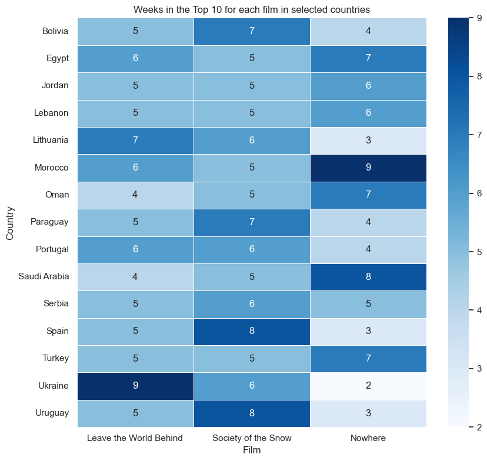

[Back to portfolio site](https://mccarthyleechris.github.io/data-science-portfolio/) · [All projects](../README.md)

# Pitching an International Film to the Netflix Board

Should Netflix fund a film made for both English and non-English audiences?

In this data storytelling project, my goal is to pitch a new film to the Netflix board. Using Netflix's public Top 10 data, I researched markets and built six visuals that drive a narrative to secure funding. One key finding is that films do better when most of the effort goes into the launch window. I also found that both English and non-English audiences offer markets with high view counts and staying power.



## The pitch

> Fund a film built for both domestic and international audiences. Choose target countries where similar films have held a Top 10 spot the longest and put most of the marketing into the launch window.

## Findings

- Both English and non-English films rank among Netflix's biggest titles by views in their first 91 days.
- Non-English films hold a steady share of weekly Top 10 film views across the whole period.
- The three case-study films got most of their views in their first few weeks in the Top 10, so the release window decides most of a film's audience.
- The median film stayed in a country's Top 10 for 4 to 5 weeks, and up to 8 or 9 weeks in its strongest markets.
- How long a film lasts varies a lot by country. The heatmap shows where each film held on longest, which helps choose target markets.

## Case-study films

| Film | Category |
|---|---|
| Leave the World Behind | Films (English) |
| Society of the Snow | Films (Non-English) |
| Nowhere | Films (Non-English) |

## The six visuals

1. [Biggest films by views in their first 91 days, English versus non-English](figures/01-biggest-films-english-vs-non-english.png) (bar chart)
2. [Non-English share of weekly film views, with a 4-week rolling average](figures/02-non-english-share-of-weekly-views.png) (line chart)
3. [Views versus "country-weeks" in the Top 10](figures/03-views-vs-country-weeks.png) (scatter plot)
4. [Weekly global views across each film's Top 10 run](figures/04-weekly-views-during-top10-run.png) (line chart)
5. [Weeks in each country's Top 10, per film](figures/05-weeks-in-each-country-top10.png) (box plot)
6. [Weeks in the Top 10 in the 15 strongest countries](figures/06-top10-weeks-heatmap-by-country.png) (heatmap)

## Data

Source: [Netflix Top 10](https://www.netflix.com/tudum/top10) public data files

| File | Rows | What it contains |
|---|---|---|
| `all-weeks-global-netflix(Top 10).csv` | 5,840 | Weekly global Top 10, with hours and views |
| `all-weeks-countries-netflix(Top 10).csv` | 272,260 | Weekly Top 10 for each country |
| `most-popular-netflix(Top 10).csv` | 40 | All-time most popular titles (first 91 days) |

The weekly data runs from June 2023 to April 2024.

## Design choices

The audience is the Netflix board, a group of non-technical decision makers, and the goal is to secure funding for an international film. Each chart makes one point, uses a colorblind-safe palette, and has a plain title that states what it shows.

## Ethical considerations

The data comes from Netflix itself, so I trust it. It only covers titles that made the Top 10, though, and it reports views without audience demographics. The pitch uses these findings to point in a direction; they can't forecast how a specific film will do.

## Limitations

The data doesn't show how long a film spent outside the Top 10 before reaching it, so timelines may differ, and marketing could shorten the runway. Films tied to a country's culture probably have an advantage in that domestic market; how that combines with global appeal is an open question.

## Repository contents

```
netflix-international-film-pitch/
├── README.md
├── netflix_film_pitch.ipynb   # analysis and all six visuals
├── data/                      # Netflix Top 10 CSV files (see data/README.md)
└── figures/                   # the six exported visuals
```

## How to run

```
pip install pandas matplotlib seaborn jupyter
jupyter notebook netflix_film_pitch.ipynb
```

## Tools

Python, pandas, matplotlib, seaborn, Jupyter
