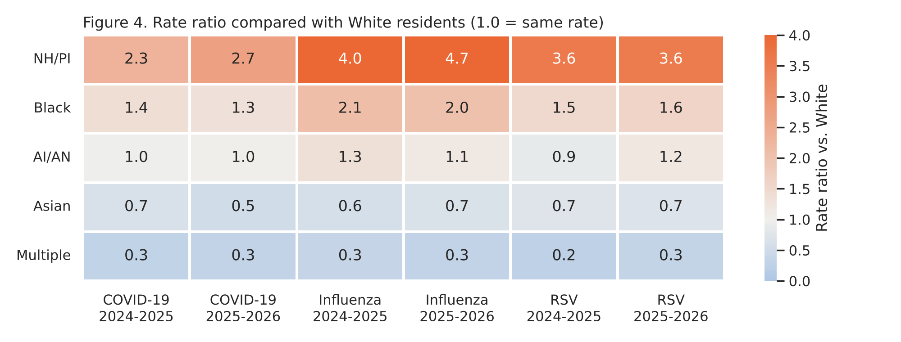

[Back to portfolio site](https://mccarthyleechris.github.io/data-science-portfolio/) · [All projects](../README.md)

# Respiratory Illness Hospitalizations by Demographic Group in Washington

Which groups in Washington are hospitalized most often for COVID-19, flu and RSV, and do those gaps hold from one season to the next?

Public health teams have limited outreach and vaccine budgets, so they need to know where hospitalizations are concentrated. Washington joined the CDC's RESP-NET hospital surveillance network in 2024, which makes this the first time these patterns can be checked with Washington data. RESP-NET covers eight counties that hold over 70% of the state's population.



## Results

- **Race and ethnicity:** Native Hawaiian and Pacific Islander (NH/PI) residents had the highest rates for all three illnesses, at 2.3 to 4.7 times the White rate. Black residents were next at 1.3 to 2.1 times. The largest gaps were for flu: NH/PI residents averaged 8.3 flu hospitalizations per 100,000 over 4 weeks, compared with 2.0 for White residents.
- **National comparison:** the Black-to-White flu ratio here (about 2.0) is close to the national figure of 1.8.
- **Age:** adults 65 and older had the highest COVID-19 and flu rates, and adults 75 and older were higher still. For RSV, the pattern flips: infants under 1 reached 11.1 per 100,000.
- **Consistency:** overall rates fell in 2025-26, but the gaps between groups barely moved. The rate ratios for the two seasons have a correlation of 0.99.

| Model (linear regression on log rate) | Inputs | Cross-validated R² (5 folds) |
|---|---|---|
| Baseline | Month, illness, season | 0.36 ± 0.04 |
| Full | Month, illness, season + race | **0.52 ± 0.06** |

Adding race raised R² from 0.36 to 0.52, so race explains a real share of the differences even after accounting for timing. The model's adjusted rate ratios were 2.09 for NH/PI and 1.40 for Black residents. Both groups stayed above the White rate under every way of handling zero-rate weeks that I tested.

## Recommendations

1. Focus flu outreach on NH/PI and Black communities.
2. Keep adults 75 and older at the top of the list for COVID-19 and flu vaccination.
3. Aim RSV prevention at infants.
4. Work with community organizations so outreach fits the communities it serves.
5. Encourage hospitals to record self-reported race, so small-group rates become more reliable.

## Data

- Source: [WA DOH Respiratory Illness Data Dashboard](https://doh.wa.gov/data-and-statistical-reports/diseases-and-chronic-conditions/communicable-disease-surveillance-data/respiratory-illness-data-dashboard), hospitalizations download (updated October 13, 2026)
- Size: 58,644 rows in long format; 6,532 rows after cleaning
- Each value is a rolling 4-week hospitalization rate per 100,000 people, with a 95% confidence interval
- Seasons: 2024-25 and 2025-26 (October to September)

Cleaning kept only the RESP-NET counties (the only rows broken down by demographic group) and complete seasons, and dropped "Combined conditions." It also split the metric column into rate, lower and upper columns and removed the "Unknown" groups. Missing weeks were left out of averages rather than filled in.

## Approach

1. Averaged each group's weekly rates over each season.
2. Divided each race group's average by the White average to get a rate ratio.
3. Fit a linear regression predicting log(rate + 0.1) from race, illness, season and month, validated with 5-fold cross-validation against a baseline that leaves race out.
4. Tested other ways of handling zero-rate weeks as a sensitivity check.

Poisson regression is the usual choice for disease counts, but DOH publishes rates, not counts. A random forest might fit more closely, but it wouldn't give one clear "times higher" number per group that a public health audience can use.

## Limitations

- The data covers only the eight RESP-NET counties, which are mostly urban.
- Small groups (AI/AN, Multiple races, NH/PI) have wide confidence intervals; the AI/AN result changed depending on how zero weeks were handled, so I treat it as uncertain.
- The DOH dashboard notes say race rates are age-adjusted, but the downloaded file doesn't label them that way.
- The data shows which groups are most at risk, not why.

## Repository contents

```
respiratory-hospitalizations-wa/
├── README.md
├── respiratory_hospitalizations_analysis.ipynb   # all cleaning, analysis, charts and modeling
├── data/                                          # DOH downloads go here (see data/README.md)
├── figures/                                       # 5 report figures + model residuals
├── report/
│   └── respiratory_hospitalizations_white_paper.pdf
└── presentation/
    └── respiratory_hospitalizations_presentation.mp4   # recorded presentation (1.5x speed)
```

## How to run

```
pip install pandas numpy matplotlib seaborn scikit-learn jupyter
jupyter notebook respiratory_hospitalizations_analysis.ipynb
```

The notebook saves its charts to `figures/`. I've re-run it on DOH downloads from October and November 2026, and the results changed by 0.02 or less.

## Tools

Python, pandas, NumPy, matplotlib, seaborn, scikit-learn, Jupyter
