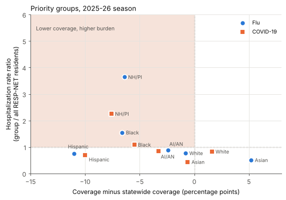

[Back to portfolio site](https://mccarthyleechris.github.io/data-science-portfolio/) · [All projects](../README.md)

# Vaccination Coverage vs. Respiratory Hospitalizations in Washington

Across groups in Washington, is higher vaccination coverage associated with lower hospitalization rates for COVID-19, flu and RSV? Which groups combine low coverage with high hospitalization?

This builds on my [respiratory hospitalizations project](../respiratory-hospitalizations-wa/), which found that NH/PI and Black residents had the highest hospitalization rates. Statewide coverage is falling: COVID-19 coverage dropped from 19.6% in 2023-24 to 15.3% in 2025-26, and flu coverage from 31.2% to 29.1%. Health departments need to decide where outreach will do the most good.



## Results

1. **Association:** across the six race/ethnicity groups, higher flu and COVID-19 coverage went with somewhat lower hospitalization rates (Spearman -0.20 to -0.37). Without Hispanic residents, the correlations were much stronger (-0.70 to -0.90). The hypothesis got limited support, and the result depends on which groups are included.
2. **By illness:** the inverse association was clearest for flu, then COVID-19. RSV was inconclusive, because the RSV coverage measures (adults 75+ and infants) don't cover the same people as the all-ages hospitalization rate.
3. **Priority groups:** NH/PI and Black residents had below-statewide coverage and above-average hospitalization for both flu and COVID-19 in both seasons. In 2025-26, NH/PI residents were 6.4 points below statewide flu coverage with 3.6 times the average flu rate.
4. **Age:** across age groups the relationship reverses (Spearman 0.8 to 1.0). Adults 65 and older have both the highest coverage and the highest risk, so age is a confounder, not evidence that vaccines raise risk.

| Model (flu + COVID-19, race/ethnicity) | Leave-one-group-out error factor | In-sample R² |
|---|---|---|
| Illness + season | 1.70x | 0.58 |
| Illness + season + coverage | 1.89x | 0.66 |
| Illness + season, no Hispanic | 1.81x | 0.57 |
| Illness + season + coverage, no Hispanic | **1.46x** | 0.88 |

Adding coverage didn't improve predictions for held-out groups in the main six-group model. In the model without Hispanic residents, it cut the error factor from 1.81x to 1.46x. The swing shows how much the result depends on group composition, and coverage likely also reflects other differences such as access to care.

## Recommendations

1. Prioritize NH/PI and Black communities for flu and COVID-19 outreach.
2. Pair vaccination outreach with efforts to improve access to care, since coverage explains only part of the gap.
3. Study why Hispanic residents in Washington have low coverage but below-average hospitalization rates before redirecting resources.
4. Ask DOH to publish hospitalization rates by vaccination status again.

## Data

Both sources are public, aggregated WA DOH data:

- **Vaccination coverage:** 13 tables from [WA DOH Respiratory Immunization Data](https://doh.wa.gov/data-and-statistical-reports/health-behaviors/immunization/respiratory-immunization-data) (Washington Immunization Information System, data as of November 9, 2026). Percent vaccinated per season by county, race/ethnicity, age group and sex. 653 rows after reshaping.
- **Hospitalizations:** the same [RESP-NET file](https://doh.wa.gov/data-and-statistical-reports/diseases-and-chronic-conditions/communicable-disease-surveillance-data/respiratory-illness-data-dashboard) as the first project (58,644 rows; 10,395 weekly rate rows kept for 2024-25 and 2025-26).

Matching the two sources produced three tables: race/ethnicity (48 rows), age (20 rows) and county (48 rows). Coverage reports Hispanic as its own group, while RESP-NET reports Hispanic ethnicity separately from race. Because that match crosses two systems, every result is also reported without Hispanic residents.

This is an ecological study: no individual's vaccination record is linked to their hospitalization record, so it compares groups and can't measure how well a vaccine protects a person.

## Approach

1. Cleaned and reshaped the 13 coverage tables, then matched groups and combined age bands (weighted by birth years) to fit RESP-NET's.
2. Spearman correlation for each illness, season and comparison set (race/ethnicity, age, county). Rank-based correlation is less sensitive to the very high NH/PI rates.
3. A pooled linear regression of log hospitalization rate on illness, season and coverage, with leave-one-group-out cross-validation so the same group never appears in both training and testing, plus a group-level bootstrap interval.
4. A priority matrix comparing each group's coverage gap with its hospitalization rate ratio.

## Limitations

- Six race/ethnicity groups and two seasons give little statistical power.
- Coverage by race and age is statewide, while hospitalizations cover eight counties.
- County rates aren't age-adjusted.
- Small groups have more missing low-count weeks, which may push their averages up.

## Repository contents

```
vaccination-coverage-hospitalizations-wa/
├── README.md
├── final_project_vaccination_analysis.ipynb   # all preparation, matching, analysis, validation and figures
├── data/raw/                                  # DOH downloads go here (see data/raw/README.md)
├── figures/                                   # 5 figures
├── report/
│   ├── vaccination_coverage_white_paper.pdf
│   └── vaccination_coverage_slides.pdf
└── presentation/
    └── vaccination_coverage_presentation.mp4  # recorded presentation (1.35x speed)
```

## How to run

```
pip install pandas numpy matplotlib scipy scikit-learn jupyter
jupyter notebook final_project_vaccination_analysis.ipynb
```

The notebook reads from `data/raw/` and saves charts to `figures/`.

## Tools

Python, pandas, NumPy, SciPy, scikit-learn, matplotlib, Jupyter
