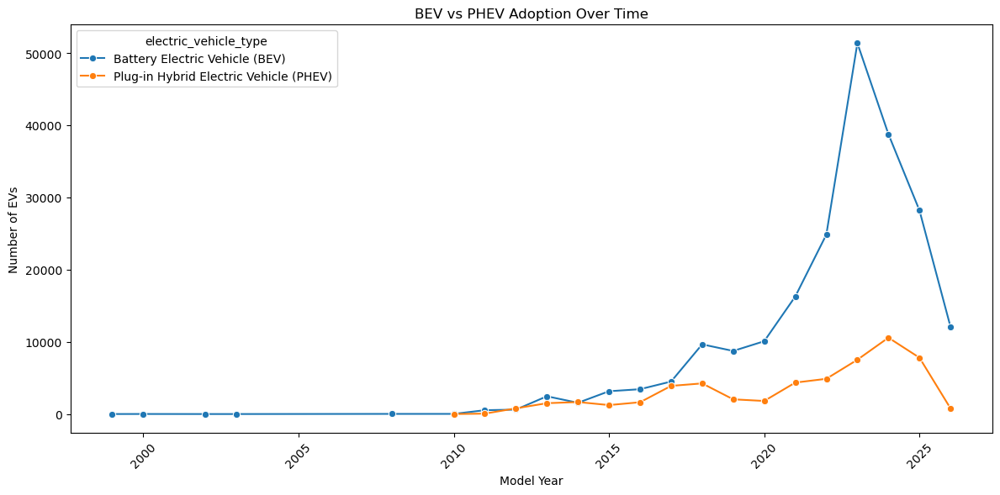

[Back to portfolio site](https://mccarthyleechris.github.io/data-science-portfolio/) · [All projects](../README.md)

# Washington EV Adoption Trends and Manufacturer Classification

How has electric vehicle adoption grown in Washington State, and can a vehicle's traits predict whether it was made by one of the state's most popular EV manufacturers?

Washington publishes a record of every registered EV in the state. This project uses that file (about 271,000 vehicles) to look at growth by model year, the split between battery-electric cars (BEVs) and plug-in hybrids (PHEVs), and each manufacturer's share. It then trains classifiers to predict whether a vehicle comes from a high-adoption manufacturer.



## Results

| Model | Accuracy |
|---|---|
| Baseline (always predict the majority class) | 0.64 |
| Decision tree | 0.77 |
| Random forest (100 trees) | **0.81** |

- Tesla leads by a wide margin with about 110,500 registered vehicles, followed by Chevrolet, Nissan, Ford and Kia.
- Battery-electric registrations rose much faster than plug-in hybrids after 2020.
- In the decision tree, whether a vehicle is fully battery-electric was the most important feature (importance 0.57), followed by vehicle age (0.25) and electric range.
- Both models identify high-adoption manufacturers well (random forest recall 0.99) but miss many vehicles from other brands (recall 0.47). The features describe the car, not the brand, so many vehicles from smaller brands look similar to vehicles from the top five.

## Data

- Source: [Electric Vehicle Population Data, Washington State Department of Licensing (data.wa.gov)](https://data.wa.gov/Transportation/Electric-Vehicle-Population-Data/f6w7-q2d2)
- Size: 271,113 rows, 16 columns (about 65 MB, so it isn't stored in this repo)
- Target: `high_adoption_manufacturer`, which is 1 if the make is one of the five most registered (Tesla, Chevrolet, Nissan, Ford, Kia) and 0 otherwise. About 64% of vehicles fall in class 1.
- Features: `is_bev` (battery-electric or plug-in hybrid), `vehicle_age` (2026 minus model year), `electric_range`

## Approach

1. Exploratory analysis: registrations by model year, top 10 manufacturers, BEV vs. PHEV trends, and Clean Alternative Fuel Vehicle (CAFV) eligibility.
2. Feature engineering: built the target and the `is_bev` and `vehicle_age` features.
3. Modeling: stratified 80/20 train/test split, then a decision tree and a random forest.
4. Evaluation: accuracy, classification reports, a confusion matrix and feature importance.

## Repository contents

```
wa-ev-adoption-classification/
├── README.md
├── wa_ev_adoption_classification.ipynb   # full analysis notebook
├── data/                                 # download the CSV here (see data/README.md)
├── figures/                              # 6 exported charts
└── report/
    └── wa_ev_adoption_report.pdf         # written report
```

## How to run

```
pip install pandas numpy matplotlib seaborn scikit-learn jupyter
jupyter notebook wa_ev_adoption_classification.ipynb
```

Download the CSV from data.wa.gov (Export → CSV) and save it as `data/Electric_Vehicle_Population_Data.csv`.

## Limitations and next steps

Three features are not enough to separate brands well, which shows in the low recall for class 0. The state keeps updating this file, so a fresh download will give slightly different counts. Next, I'd add features such as base MSRP, county and legislative district, and try class weighting to improve recall for smaller brands.

## Tools

Python, pandas, matplotlib, seaborn, scikit-learn, Jupyter
